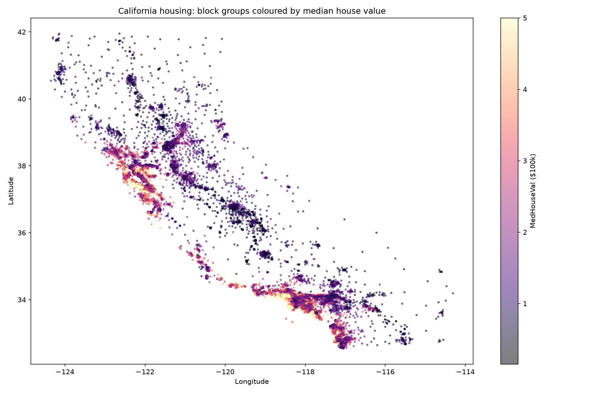
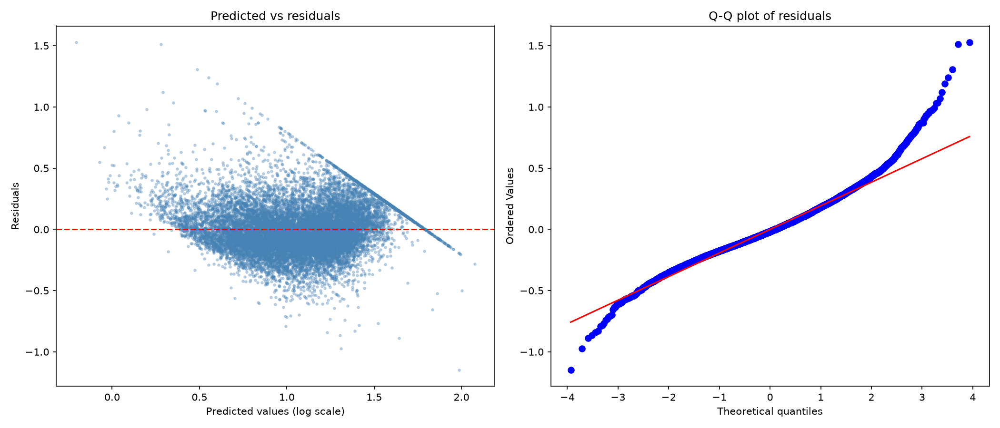

# Explaining House Values in California

An OLS regression model of median house values across 20,640 California census block groups (1990 census). The
focus is on careful data preparation, engineering geographic features, and honest diagnostics.

**Tools:** Python · pandas · NumPy · scikit-learn · SciPy · Matplotlib · seaborn

## Question

What drives house values across California, and how much does *location* add beyond income and housing
characteristics?

## Approach

1. **EDA:** a correlation heatmap and a map of block groups coloured by house value.
2. **Cleaning without leakage:** split 80/20 first, then winsorise the extreme tails of four per-household
   variables at the 1st/99th percentiles. The thresholds come from the training set only and are then applied to
   the test set.
3. **Skewness correction:** `log1p` applied to features with |skew| > 1 and to the target.
4. **Feature engineering:** distance to Los Angeles, distance to San Francisco, and distance to the nearest of
   eight coastal reference points. These let a linear model capture the non-linear coastal pattern.
5. **Modelling:** standardised features, OLS, and RMSE/R² on a held-out test set after back-transforming
   predictions to dollar units.
6. **Diagnostics and ablation:** residual and Q-Q plots, plus re-fits without the geographic features and without
   the log transforms.

## Results

| Model | Test RMSE ($100k) | Test R² |
|---|---|---|
| **Full model** | **0.657** | **0.671** |
| Without geographic features | 0.673 | 0.655 |
| Without log-transformed features | 0.701 | 0.626 |

- **Income dominates**, with a correlation of 0.69 with house value and the largest coefficient.
- **Location matters:** all three distance features have negative coefficients, and removing them worsens fit on
  unseen data.
- **The log transforms help:** reverting the skewed features to their raw scale cuts test R² by about 0.05.
- **Train and test scores are almost identical** (train R² 0.689 vs test 0.671), so the model is not overfitting.



## Diagnostics and limitations



- **Heteroscedasticity:** the residual spread fans out with the predicted value. The straight diagonal edge comes
  from the $500k cap on the target. Point predictions are usable, but default OLS standard errors would not be
  reliable.
- **Heavy-tailed residuals** in the Q-Q plot show that some extreme observations are still not fully explained.
- `AveBedrms` stays skewed even after the log transform, so trimming it might work better than winsorising.

## Run it

```bash
pip install -r requirements.txt
jupyter notebook california_house_values.ipynb
```

The dataset is downloaded automatically through `sklearn.datasets.fetch_california_housing`.

## About

This started as coursework for *Methods for Data Analytics II* (BSc Economics and Data Analytics, University of
Leicester, 2025/26) and was reworked into a standalone portfolio notebook. The analysis and code are my own; the
notebook was restructured for presentation with help from Claude Code.

**Yash Karavadra** · [LinkedIn](https://www.linkedin.com/in/yash-karavadra-88619b330/)
